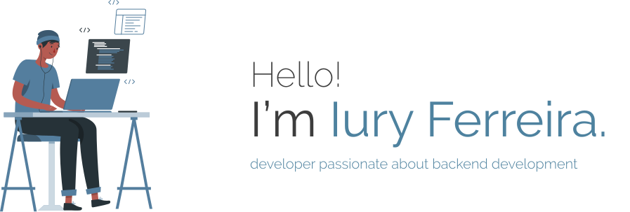

  

<h3 align="center">Engenheiro de Software | .NET &amp; Azure</h3>

Arquitetura de Software · Desenvolvimento Backend · Desenvolvimento de Produtos

  
  

## Sobre mim

Sou engenheiro de software especializado em .NET, Azure e arquitetura de software, com foco na resolução de problemas complexos de negócio por meio da tecnologia.

Minha experiência profissional abrange projetos internacionais, sistemas bancários, serviços financeiros, meios de pagamento, recuperação de crédito, investimentos e e-commerce. Ao longo da minha trajetória, contribuí para o desenvolvimento e na modernização de sistemas críticos, lidando com regras de negócio complexas, integrações, desafios de desempenho e melhorias arquiteturais.

Acredito que a engenharia de software vai além de escrever código. Envolve compreender as necessidades do negócio, tomar decisões técnicas fundamentadas e entregar soluções confiáveis, de fácil manutenção e que gerem resultados relevantes.

Além da minha experiência profissional, desenvolvo produtos independentes, bibliotecas de código aberto e ferramentas para desenvolvedores, transformando ideias em soluções práticas.

## Áreas de atuação

| Área | Foco |
| --- | --- |
| Desenvolvimento Backend | APIs, regras de negócio e integrações complexas |
| Arquitetura de Software | Manutenibilidade, escalabilidade e sistemas distribuídos |
| Cloud e DevOps | Infraestrutura em nuvem, automação e observabilidade |
| Sistemas Financeiros | Bancos, pagamentos, investimentos e recuperação de crédito |
| Modernização de Sistemas | Migração de legados, confiabilidade e desempenho |
| Desenvolvimento de Produtos | Produtos independentes e soluções reutilizáveis |

## Tecnologias

  
  
  
  
  
  

| Área | Tecnologias e práticas |
| --- | --- |
| Backend | C#, .NET, ASP.NET Core, Entity Framework Core, NHibernate |
| Arquitetura e Integração | DDD, Clean Architecture, Microservices, REST, gRPC, GraphQL, SOAP, Kafka |
| Dados e Persistência | SQL Server, PostgreSQL, MySQL, Redis, MongoDB |
| Infraestrutura e DevOps | Azure, Docker, Terraform, Bicep, Azure DevOps, Git, Linux, CI/CD |
| Observabilidade | Application Insights, OpenTelemetry, logs estruturados, rastreamento distribuído |
| Frontend e Tecnologias Complementares | Blazor, Angular, Vue.js, TypeScript, Python, Node.js |

## Projetos em destaque

### [Idigis](https://idigis.com.br)
Plataforma de gestão eclesiástica que reúne membros, congregações, finanças, documentos, agenda e comunicação. Desenvolvida com ASP.NET Core, Blazor WebAssembly, Entity Framework Core e Azure.

### Semea
Plataforma de impacto social que conecta doadores a iniciativas sociais por meio de doações pontuais e recorrentes via Pix, gamificação e comunicação em tempo real. Desenvolvida com .NET, Blazor WebAssembly, SignalR, OpenTelemetry e Azure.

### Bibliotecas de código aberto

- **[Notie](https://github.com/iuryferreira/notie):** Biblioteca de notificações para o ecossistema .NET.
- **[Hashio](https://github.com/iuryferreira/hashio):** Biblioteca .NET para criptografia de dados.

## Além do código

Desenvolvedor por vocação, músico por amor e teólogo por devoção.

  <strong>Vamos conversar.</strong> 
  <a href="https://www.linkedin.com/in/iury-ferreira-68ba35130/">LinkedIn</a> · <a href="mailto:iury.franklinferreira@gmail.com">Email</a>

